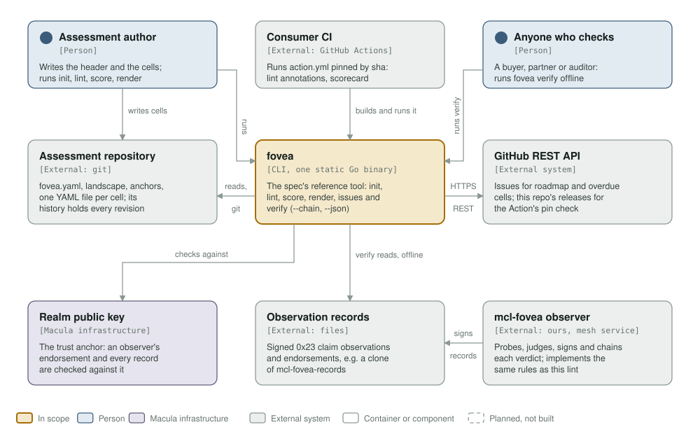
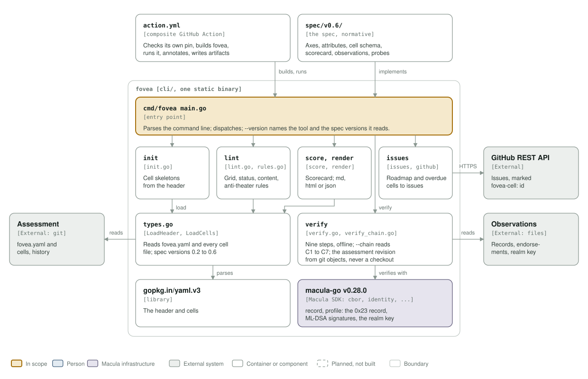

# macula-fovea architecture: C4 model

*This exists so a security assessment is data a tool can lint, score and render, and a signed observation of a claim can be checked offline by anyone.*

**Status: tool 0.4.0** (`docs/CHANGELOG.md`, tag `v0.4.0`), reading spec 0.2 to 0.6; spec v0.6 is current. macula-fovea is the fovea spec (`spec/`) and its reference implementation, the `fovea` CLI (`cli/cmd/fovea`, one static Go binary), which the GitHub Action (`action.yml`) builds and runs in a consumer's CI.

Legend, the same in both diagrams: amber is the element in scope, blue a person, lavender-grey **Macula infrastructure** (a realm's key, the macula-go SDK), grey-green an external system, white a component, a thin solid rounded outline with a muted label a boundary, and dashed boxes are planned, not built (none here).

## Level 1: system context

| Element | Kind | Role |
| --- | --- | --- |
| fovea | In scope | The spec's reference tool: `init`, `lint`, `score`, `render`, `issues`, `verify` (`--chain`, `--json`) |
| Assessment author | Person | Writes the assessment header and one YAML file per cell; runs `init`, `lint`, `score`, `render` |
| Consumer CI | External (GitHub Actions) | Runs `action.yml` pinned by commit sha: lint failures as PR annotations, `score.json` and the scorecard as artifacts and a job summary |
| Anyone who checks | Person | Runs `fovea verify` offline on a signed observation, or `--chain` on a kept slot |
| Assessment repository | External (git) | `fovea.yaml`, landscape, trust anchors and the cells; `verify` reads the revision an observation names from git's object store (`--repo`, `--path`, `--ref`), never a checkout |
| GitHub REST API | External system | `fovea issues` syncs roadmap and overdue cells to issues, idempotently, by a body marker; the Action's pin check reads this repository's releases |
| Realm public key | Macula infrastructure | The trust anchor `verify` checks the observer's realm member endorsement and every record against (`--realm-key`, `--realm`, `--profile`) |
| Observation records | External (files) | Signed 0x23 claim observations and endorsements, hex or raw, for example a clone of mcl-fovea-records |
| mcl-fovea observer | External (ours, a mesh service) | Probes, judges, signs and chains each verdict; it implements the same rules as this lint and answers to its conformance cases |

## Level 3: components of the fovea binary

| Component | Kind | Role |
| --- | --- | --- |
| `action.yml` | Composite GitHub Action | Checks its own pin (`scripts/fovea-pin-self.sh`), builds fovea at the pinned ref, runs it, annotates, writes artifacts |
| `spec/v0.6/` | The spec, normative | Axes, attributes, cell schema, scorecard, observations, probes: what the CLI implements |
| `cmd/fovea` `main.go` | Entry point | Parses the command line, dispatches; `--version` names the tool and the spec versions it reads |
| `init` | `init.go` | Creates missing cell skeletons from the header |
| `lint` | `lint.go`, `lint_v04.go`, `rules.go` | The fixed grid, the status and content rules and the anti-theater rules, each proven by a rule case under `cli/internal/core/testdata/` |
| `score`, `render` | `score.go`, `render.go`, `render_html.go` | The scorecard metrics; the grid as markdown, HTML or JSON |
| `issues` | `issues.go`, `github.go` | Roadmap and overdue cells to GitHub issues over the REST API (stdlib client), marked `fovea-cell: <id>` |
| `types.go` | `LoadHeader`, `LoadCells` | Reads `fovea.yaml` and every cell file, for spec versions 0.2 to 0.6 |
| `verify` | `verify.go`, `verify_chain.go`, `verify_json.go` | The nine verification steps, offline; `--chain` reads a slot's continuity (C1 to C7); `--json` |
| `gopkg.in/yaml.v3` | Library | Parses the header and the cells |
| macula-go v0.21.0 | Macula SDK | `record`, `identity`, `profile`, `cbor`: the 0x23 record, ML-DSA signatures, the realm key |

## Editing the diagrams

Both SVGs in [`../assets/`](../assets/) are generated by [`c4_diagrams.py`](c4_diagrams.py): run `python3 architecture/c4_diagrams.py` from the repository root, render each (`rsvg-convert -w 1400 assets/c4-context.svg -o /tmp/c.png`) and look at it. Colours are plain classes with a `prefers-color-scheme: dark` block, never CSS custom properties, which `rsvg-convert` renders black. Keep this file's tables in step with the diagrams; the `c4-model.yml` workflow fails when a diagram goes missing or unlinked.
